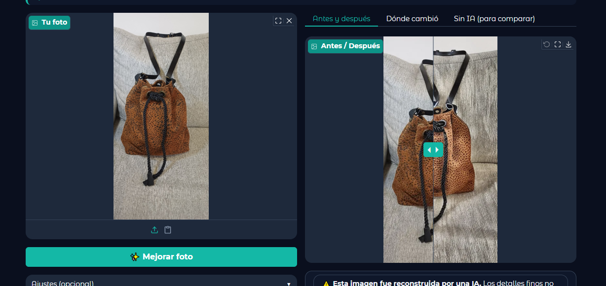
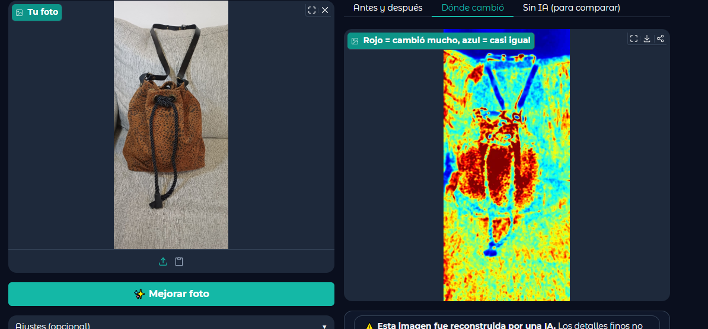
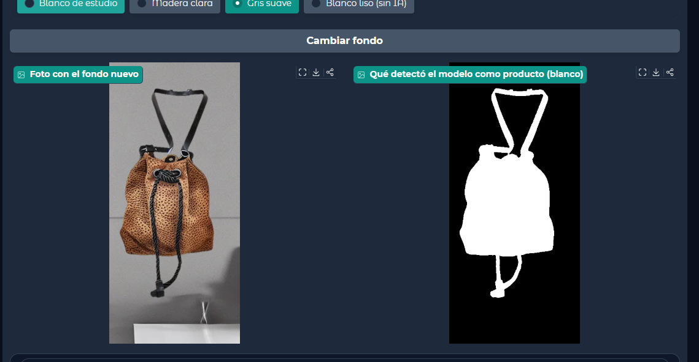

# Restaurador de fotos de productos

> Limpia el ruido y el desenfoque de las fotos de tus productos con IA, y te muestra qué cambió para que no se oculte ningún defecto real.

**Trabajo Integrador N°2** — Procesamiento Digital de Imágenes e Introducción a Visión por Computadora · IFTS 24 · 2026

> **Estado:** entrega final (18/11/2026). **Sub-tarea elegida: B (denoising/deblurring).** Hay además una exploración fuera del MVP (ver [Exploración fuera del MVP](#exploración-fuera-del-mvp-separar-producto-y-escena)).

## Persona usuaria

**Camila**, 28-35 años. Vende ropa y accesorios usados por marketplace como ingreso extra. Usa el celular todo el día pero no sabe nada de IA.

- **Problema:** saca las fotos de noche o en un cuarto mal iluminado; salen con ruido y movidas, y vende menos. Además suele tener un fondo poco prolijo (cama, piso).
- **Frustraciones:** las apps de "mejorar foto" cambian los colores o "arreglan" la prenda; le preocupa que el comprador reclame porque la prenda se ve mejor que en la realidad.
- **Objetivo:** fotos más limpias sin ocultar defectos reales (manchas, desgaste). Opcionalmente, un fondo más prolijo sin que el producto cambie.

## Declaración del proyecto

Mi sistema permite que Camila (vendedora de ropa usada) pueda limpiar el ruido y el desenfoque de las fotos de sus productos aplicando Stable Diffusion 1.5 con ControlNet tile a baja intensidad, y verificando con RT-DETR que no aparezcan ni desaparezcan objetos. Le advierte que los detalles finos fueron reconstruidos por una IA y le muestra un mapa de diferencias para que revise que no se tapó ningún defecto real. Como paso opcional, puede cambiar el fondo de la foto: ahí la IA solo genera el fondo y el producto conserva sus píxeles.

## Estructura

```
app.py               Interfaz Gradio (MVP: sub-tarea B)
src/imagenes.py      Carga y preparación de imágenes
src/diffusion.py     Difusión (SD 1.5 + ControlNet tile)
src/clasico.py       Filtros clásicos y corrección de iluminación (sin IA)
src/analysis.py      Análisis visual con RT-DETR
src/honesty.py       Mapa de diferencias, aviso e informes
src/metricas.py      PSNR, SSIM y degradación reproducible de fotos
src/segmentacion.py  Paso 2 opcional: máscara del producto con BiRefNet
src/escena.py        Paso 2 opcional: fondo con SD inpainting y composición
exploracion/         App completa de la exploración (solo fondo), fuera del MVP
scripts/             Pruebas sin interfaz y evaluación PSNR/SSIM
colab/               Notebooks para ejecutar en Google Colab o Kaggle
docs/                Registro de decisiones y evidencias
tests/               Verificaciones mínimas
```

## Exploración fuera del MVP: separar producto y escena

La consigna pide elegir **una** sub-tarea (A, B o C). Elegimos la **B**. Antes de confirmarlo exploramos otra idea que no encaja en ninguna de las tres, y por eso quedó fuera del MVP, pero la dejamos documentada porque enseña algo sobre lo real y lo inventado.

**De dónde salió.** Al probar la sub-tarea B con fotos reales, el modelo **alteraba logos, botones y estampados del producto** y, a intensidad baja, casi no mejoraba nada. Además, en las fotos reales de marketplace que reunió Álvaro, el problema grande era el fondo mal tomado y la mala luz. Probamos entonces **separar producto y escena**: BiRefNet recorta el producto, Stable Diffusion inpainting genera solo el fondo y los píxeles originales del producto se pegan encima.

| Original | Retocado por la IA (sub-tarea B) | Mapa de diferencias |
|---|---|---|
|  |  |  |

**Qué pasó.** Con el producto a la vista, el inpainting inventó objetos (una persona que llevaba el bolso, un soporte de estudio). Al generar el fondo **sin que el modelo vea el producto**, en un cuadrado de 512 px, el resultado mejoró mucho: el producto queda intacto, pero con límites que se ven en la captura (la máscara incluyó un dedo de la mano que sostenía el bolso, y no hay sombra de contacto).


**Por qué quedó fuera del MVP.** Cambiar el fondo no es denoising, super-resolución ni restauración de fotos antiguas, y la consigna exige una de esas tres. Por eso el núcleo es la sub-tarea B, y el fondo se integró solo como **paso 2 opcional** de la app (se carga la primera vez que se usa). El detalle de la decisión y las alternativas está en [`docs/decisiones.md`](docs/decisiones.md). El estado exacto de la exploración está en la etiqueta de git `exploracion-escena` y el código en `src/segmentacion.py`, `src/escena.py` y `exploracion/`.

## Qué es real y qué es inventado

**Lo que el modelo hace.** Stable Diffusion 1.5 con ControlNet *tile* rehace la foto a baja intensidad (por defecto 0,3): conserva la composición y los colores generales y **reconstruye los detalles finos**. Esos detalles no se recuperan de la foto original: **son una estimación de la IA**. Con ruido o desenfoque fuerte, la información real ya se perdió y el modelo la reemplaza por una versión plausible.

**Lo que se ve en la app.** Después de cada mejora, Camila ve:
- un aviso fijo: *los detalles finos fueron reconstruidos por una IA, revisá que no falte ni se agregue nada*;
- el **mapa de diferencias** (pestaña "Dónde cambió") y el porcentaje de píxeles que cambiaron;
- la versión **sin IA** (filtro bilateral) para comparar;
- un chequeo con RT-DETR que avisa si apareció o desapareció un objeto (solo conoce las 80 clases de COCO; no reconoce prendas, ver [Limitaciones](#limitaciones)).




### Dónde el modelo se equivocó (evidencia real)

| Caso | Qué pasó | Archivos |
|---|---|---|
| **Porta vino de cuero**, intensidad 0,3, sin corrección de luz | El cuero quedó más brillante y saturado. El **grabado/repujado del borde** se suavizó y en la parte inferior apareció una **mancha tipo raspón que no existe** en la foto original. La etiqueta de la botella y los remaches se mantuvieron. | `docs/evidencias/denoising_deblurring/porta_vino.jpeg` → `porta_vino_editado.webp` |
| **Pan dulce envuelto**, intensidad ≥ 0,7 | A intensidad alta el modelo **reinterpretó el producto**: los moños y el celofán se convirtieron en flores blancas y amarillas con detalles verdes. Es el caso extremo: la foto "se ve bien" pero ya no es el producto. | `pan_dulce.jpeg` → `pan_dulce_editado.webp` |
| **Bolso negro con gato bordado** (primer prototipo) | Cambió el aspecto de logos y estampados a intensidad media. | `docs/evidencias/primer modelado/` |
| **Cambio de fondo** (paso 2 opcional) | La máscara dejó un **dedo de la mano** dentro del producto, las tiras finas quedan al límite y no se genera sombra de contacto. | `docs/evidencias/remover fondo/` |

Por eso el valor por defecto es **bajo (0,3)** y el mapa de diferencias es parte central del producto, no un extra.

### Evaluación con métricas (PSNR / SSIM)

`scripts/evaluar_degradacion.py` toma una foto nítida, **le agrega desenfoque y ruido sintéticos** y compara cada método contra la original. Resultados completos en `docs/evidencias/evaluacion/`. Foto: `porta_vino.jpeg`.

**Corrida 1: desenfoque σ=1,5 y ruido σ=15**

| Método | PSNR (dB) ↑ | SSIM ↑ |
|---|---|---|
| Foto degradada (sin hacer nada) | 23,84 | 0,366 |
| Filtro bilateral (clásico) | **29,23** | **0,849** |
| Filtro mediano 5x5 (clásico) | 28,47 | 0,817 |
| Difusión, intensidad 0,1 | 24,46 | 0,482 |
| Difusión, intensidad 0,3 | 23,82 | 0,491 |
| Difusión, intensidad 0,5 | 22,24 | 0,453 |

**Corrida 2: desenfoque σ=3,0 y ruido σ=8**

| Método | PSNR (dB) ↑ | SSIM ↑ |
|---|---|---|
| Foto degradada (sin hacer nada) | 24,40 | 0,528 |
| Filtro bilateral (clásico) | 25,18 | **0,820** |
| Filtro mediano 5x5 (clásico) | **25,23** | 0,808 |
| Difusión, intensidad 0,1 | 24,19 | 0,645 |
| Difusión, intensidad 0,3 | 23,65 | 0,650 |
| Difusión, intensidad 0,5 | 23,06 | 0,662 |

**Cómo leerlo (honestamente):**
- Con ruido gaussiano sintético, los **filtros clásicos le ganan a la difusión** en PSNR y SSIM. Era esperable: ese ruido es justo lo que esos filtros están pensados para quitar.
- Con desenfoque fuerte, la difusión **sí mejora el SSIM** (0,53 → ~0,65), pero **el PSNR queda por debajo de no hacer nada**: se ve más nítida, pero los detalles inventados no coinciden píxel a píxel con la realidad.
- Subir la intensidad sube un poco el SSIM y baja el PSNR. La mejor intensidad por PSNR fue **0,1**; se mantiene **0,3 por defecto** como compromiso entre efecto visible y fidelidad, y el usuario puede bajarla.
- Es **una sola foto y dos configuraciones**: no alcanza para generalizar. Y estas métricas miden *parecido con la foto buena*, **no si algo es auténtico**: un detalle inventado que se parece mucho a uno real puntúa bien igual.

## Arquitectura

```
Foto de Camila
   │
   ▼
src/imagenes.py ── preparar (lado máx. 768 px)
   │
   ├─► src/clasico.py ── filtro bilateral / corrección de luz (CLAHE + gamma)  ─► "Sin IA (para comparar)"
   │
   ├─► src/diffusion.py ── SD 1.5 + ControlNet tile (img2img, intensidad baja) ─► foto mejorada
   │
   ├─► src/analysis.py ── RT-DETR: ¿aparecieron/desaparecieron objetos?
   │
   └─► src/honesty.py ── mapa de diferencias + % cambiado + aviso + informe
                                   │
                                   ▼
                          app.py (Gradio): antes/después · dónde cambió · sin IA · informe

Paso 2 (opcional, bajo demanda)
   src/segmentacion.py (BiRefNet) ─► máscara del producto, limpiada con morfología
   src/escena.py (SD inpainting)  ─► genera SOLO el fondo, sin ver el producto
   composición alfa: los píxeles originales del producto se pegan encima
```

## Modelos y licencias

| Modelo | Uso | Licencia |
|---|---|---|
| `stable-diffusion-v1-5/stable-diffusion-v1-5` | Difusión base (sub-tarea B) | CreativeML OpenRAIL-M |
| `lllyasviel/control_v11f1e_sd15_tile` | ControlNet tile: mantiene la estructura | OpenRAIL |
| `PekingU/rtdetr_r50vd` | Verificación de objetos (COCO, 80 clases) | Apache-2.0 |
| `stable-diffusion-v1-5/stable-diffusion-inpainting` | Paso 2: generar el fondo | CreativeML OpenRAIL-M |
| `ZhengPeng7/BiRefNet` | Paso 2: separar producto y fondo | MIT |

Se descartó RMBG-2.0 por tener licencia no comercial y acceso restringido. El *safety checker* de SD está **desactivado a propósito**: daba falsos positivos y devolvía imágenes negras con prendas; se deja documentado en `docs/decisiones.md`.

Versiones fijadas en `uv.lock`: gradio 6.32.0 · diffusers 0.43.0 · transformers 5.23.0 · torch 2.15.0 · accelerate 1.16.0 · opencv-python-headless 5.0.0.93 · pillow 13.0.0 · numpy 2.5.5 · timm 1.0.31 · einops 0.8.2 · kornia 0.9.2 · pytest 9.2.0. Python 3.12.

## Hardware de prueba

- **Desarrollo:** PC personal sin GPU dedicada (solo gráfica integrada de 128 MB): ahí se desarrolló y se corrieron los tests de la parte clásica.
- **Ejecución de los modelos:** **Kaggle, GPU T4 x2** (Internet activado). Colab se usó al inicio, pero se agotó la cuota.
- **Tiempos medidos en Kaggle:** primera carga de modelos ≈ **4 minutos**; luego, **entre 15 y 60 segundos por foto** en el paso 1. El paso 2 carga BiRefNet e inpainting la primera vez que se usa.
- En CPU funciona pero es muy lento; no se recomienda.

## Instalación y ejecución

**Opción A: Kaggle o Colab (recomendada, hay GPU)**

1. Abrir `colab/ejecutar_en_kaggle.ipynb` (o `colab/ejecutar_en_colab.ipynb`) en Kaggle/Colab. En Kaggle: activar GPU T4 e Internet.
2. Ejecutar las celdas en orden. La celda final lanza la interfaz con un link público.

**Opción B: local con [uv](https://docs.astral.sh/uv/)** (necesita GPU NVIDIA para tiempos razonables)

```bash
git clone https://github.com/alvarito1709/imagenes-TI-marketplace-gen.git
cd imagenes-TI-marketplace-gen
uv sync
uv run app.py
```

**Tests** (la parte clásica, honestidad, segmentación y métricas no necesitan GPU):

```bash
uv run pytest
```

**Evaluación con PSNR/SSIM** (necesita GPU y una foto nítida en `assets/ejemplos/`):

```bash
uv run python scripts/evaluar_degradacion.py assets/ejemplos/porta_vino.jpeg 1.5 15
```

## Ejemplo de uso

1. Subir la foto (o elegir una de los ejemplos).
2. Ajustar la intensidad si hace falta (0,3 por defecto) y tocar **✨ Mejorar foto**.
3. Revisar "Antes y después", **"Dónde cambió"** y el informe.
4. (Opcional) Abrir **"Paso 2: cambiar el fondo"**, elegir un fondo y generarlo. El informe dice cuánto del producto se modificó (debe ser ~0 %).



## Decisiones de diseño (HAI)

Pensadas para una persona sin conocimientos técnicos y para que **no se la engañe**:

- **Transparencia:** el aviso de IA y el mapa de diferencias aparecen siempre, no son opcionales.
- **Control:** una sola perilla (intensidad) y una casilla de luz, escondidas en "Ajustes (opcional)". Los valores por defecto ya son seguros.
- **Comparación:** la versión sin IA al lado permite que Camila juzgue si la IA aportó algo.
- **Lenguaje simple:** el informe dice "cambió el 4 % de la foto", no habla de modelos ni de píxeles.
- **Seguridad para el comprador:** el producto nunca se regenera en el cambio de fondo; se miden y reportan los píxeles del producto modificados.
- **Interfaz:** modo oscuro, alturas de imagen fijas para que la pantalla no salte al subir una foto, paso 2 plegado para no abrumar.

## Conceptos de procesamiento digital aplicados

- **Filtrado espacial:** filtro bilateral y mediano (reducción de ruido preservando bordes).
- **Mejora de contraste e iluminación:** CLAHE y corrección gamma automática sobre el canal L del espacio L\*a\*b\*.
- **Espacios de color:** conversión RGB ↔ L\*a\*b\* para tocar solo la luminosidad.
- **Morfología matemática:** erosión y dilatación; componentes conexas para quitar islas y rellenar huecos pequeños en la máscara.
- **Composición alfa y *feathering*:** desenfoque gaussiano del borde de la máscara para pegar el producto sin cortes duros.
- **Remuestreo:** LANCZOS/bilineal al achicar y al recortar el fondo generado.
- **Degradación sintética:** desenfoque gaussiano y ruido aditivo para evaluar.
- **Métricas de calidad:** PSNR y SSIM (implementado a mano, ventana gaussiana 11×11, σ=1,5).
- **Análisis de diferencias:** mapa de calor de la diferencia absoluta y porcentaje de píxeles cambiados.
- **Detección de objetos:** RT-DETR para verificar que no aparezcan ni desaparezcan elementos.
- **Modelos generativos:** difusión latente con ControlNet (img2img) e inpainting.

## Uso de agentes de IA

Se usó **solo Claude** (Anthropic), como asistente de programación y redacción.

- **Decisiones mías:** elegir la persona y el problema; volver a la sub-tarea B cuando noté que la consigna exige una de A/B/C; mantener el cambio de fondo como paso opcional y dejar la app completa de escena como exploración; conservar la intensidad 0,3 por defecto; qué fotos usar y qué evidencia guardar; ejecutar y comparar todas las pruebas en Kaggle.
- **Propuestas de Claude que acepté:** estructura del código en `src/`, filtros clásicos como línea base, capa de honestidad (mapa de diferencias e informe), generar el fondo sin que el modelo vea el producto, evaluación PSNR/SSIM, tests.
- **Cosas que el agente hizo mal y se corrigieron con pruebas:** errores de tipos (float vs half) en BiRefNet, una métrica que marcaba falsos cambios en el borde, una máscara que rellenaba huecos legítimos entre tiras, fondos con personas y trípodes inventados.
- El registro de decisiones está en `docs/decisiones.md`.

## Limitaciones

- **La IA inventa detalle.** A intensidades altas puede reinterpretar el producto (ver pan dulce). Se recomienda quedarse en 0,1–0,3.
- **Puede borrar o alterar detalles reales:** grabados, estampados, logos, texto pequeño y defectos finos.
- **RT-DETR no conoce prendas ni accesorios** (COCO tiene 80 clases): el chequeo de objetos sirve para cosas ajenas al producto, no para verificar la prenda.
- **Frente a ruido sintético, los filtros clásicos rinden mejor** que la difusión en PSNR/SSIM; la ventaja de la difusión es perceptual y no está probada con métricas.
- **Evaluación acotada:** una foto, dos configuraciones.
- **Resolución limitada:** el paso 1 trabaja con lado máximo de 768 px porque SD 1.5 se entrenó con imágenes de 512 px.
- **Segmentación imperfecta:** puede incluir partes de la mano y comerse tiras finas; no genera sombra de contacto.
- **Requiere GPU**; el tiempo por foto es de 15–60 s en una T4.

## Capturas y video demo

- 🎥 **Video demo (5 min):** https://drive.google.com/file/d/1Mbn_7aPaPCqVbM7Ip_ke3XcimUVvyYMZ/view?usp=drive_link
- Capturas en `docs/capturas/`.
- Evidencias de pruebas en `docs/evidencias/`.

## Autor

**Álvaro Ortiz** · IFTS 24 · Tecnicatura Superior en Ciencia de Datos e Inteligencia Artificial · GitHub: [alvarito1709](https://github.com/alvarito1709) · Trabajo individual, prof. Matías Barreto.
